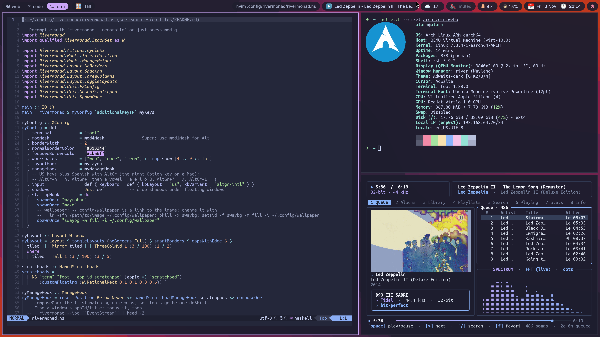

# rivermonad

An xmonad-style tiling window manager for Wayland. It is to xmonad what sway is
to i3: the same model and the same kind of Haskell configuration file, on a
Wayland compositor.


*Tall, Mirror and three-column layouts with 1 px gaps, resizing, full
screen, a window floated and resized with the mouse, workspaces, the emoji
picker, a region screenshot, the launcher and a scratchpad, with the
[waymobar](https://github.com/prietus/waymobar) bar. Full quality:
[docs/demo.mp4](docs/demo.mp4) (56 s). The setup is in
[examples/dotfiles](examples/dotfiles/README.md).*



*The Tall layout with 6 px gaps: the configuration file in nvim, fastfetch
and a terminal music player, under waymobar.*

rivermonad is **not** a compositor. It runs as the window manager process of
[river](https://codeberg.org/river/river) ≥ 0.4, which splits the compositor
(rendering, input, protocols, Xwayland) from the window manager, connected by
the stable `river-window-management-v1` protocol. Because of this split:

* if rivermonad crashes or restarts, your windows survive;
* rivermonad contains no wlroots, C or FFI code: the Wayland wire protocol is
  implemented in pure Haskell (`Rivermonad.Wayland.Wire`) and the bindings are
  generated from river's XML files (`tools/gen-protocol.py`).

## What works

* `StackSet` with an API compatible with `XMonad.StackSet`: workspaces,
  multiple monitors, floating layer
* layouts `Tall`, `Mirror`, `Full` and `|||`, plus the `Shrink`/`Expand`,
  `IncMasterN`, `NextLayout` and `JumpToLayout` messages
* `ManageHook` with `appId`/`className`, `title`, `isDialog`, `doShift`,
  `doFloat`, `doCenterFloat`, `doFullscreen` and friends
* xmonad's default key bindings (with Super as the modifier), mouse move and
  resize of floating windows, focus follows mouse
* compositor-drawn borders, client fullscreen requests and `mod-f`
* keyboard, key repeat, touchpad and mouse settings in the config file
  (river's input protocols): xkb layouts/variants/options compiled with
  libxkbcommon, `nextKeyboardLayout`, tap to click, natural scrolling,
  disable while typing, acceleration… The active layout is published over
  IPC (`keyboard_layout`, action `"NextKeyboardLayout"`):

  ```haskell
  , input = def
      { keyboard = def { kbLayout = "us,es", kbOptions = "grp:alt_shift_toggle,caps:escape"
                       , kbRepeat = Just (40, 250) }
      , touchpad = def { tapToClick = Just True, naturalScroll = Just True }
      , mouse    = def { accelProfile = Just AccelFlat }
      }
  ```
* tearing for games: a fullscreen window that asks for it
  (`wp_tearing_control`) makes its output present without vsync, back to
  vsync when it leaves; `allowTearing = False` turns it off. Pair it with
  variable refresh rate (`adaptive_sync on` in kanshi) on real hardware
* drop shadows, drawn by rivermonad as river decorations below windows
  (only under floating windows unless `shadowTiled = True`; none in
  fullscreen):

  ```haskell
  , shadows = Just def { shadowRadius = 18, shadowOffset = (0, 5)
                       , shadowColor = "#000000", shadowOpacity = 0.5 }
  ```
* layer-shell (waybar, fuzzel, …), with the space taken by bars excluded
* `~/.config/rivermonad/rivermonad.hs` recompiled with ghc; `mod-q`
  recompiles and restarts while keeping each window's workspace, stack
  position and focus, every workspace's layout state and persistent
  extensible state
* an IPC socket (newline-delimited JSON, like niri's): a state event stream
  and actions, usable from scripts with `rivermonad --ipc`
* xmonad's extension points: layouts in `X` (`doLayout`, `handleMessage`),
  `LayoutModifier`, `ExtensibleState`, `handleEventHook`

## Contrib modules

Ports of the most used xmonad-contrib modules ship in the same package, with
the `XMonad.` prefix replaced by `Rivermonad.`:

| Module | What it does |
|---|---|
| `Rivermonad.Util.EZConfig` | `additionalKeysP` with `"M-S-<Return>"`-style strings |
| `Rivermonad.Util.SpawnOnce` | `spawnOnce`: start programs once per session, not per restart |
| `Rivermonad.Util.NamedScratchpad` | toggleable scratchpad windows |
| `Rivermonad.Util.ExtensibleState` | typed state for your own modules (`XS.get`/`XS.put`) |
| `Rivermonad.Actions.CycleWS` | `nextWS`, `prevWS`, `toggleWS`, `moveTo Next EmptyWS`, screens |
| `Rivermonad.Hooks.ManageHelpers` | `composeOne`, `-?>`, `doRectFloat`, `doFullFloat`, `transience` |
| `Rivermonad.Hooks.InsertPosition` | `insertPosition Below Newer` |
| `Rivermonad.Hooks.StatusBar` | status line for waybar (see below) |
| `Rivermonad.Layout.LayoutModifier` | write your own layout modifiers |
| `Rivermonad.Layout.NoBorders` | `noBorders`, `smartBorders` |
| `Rivermonad.Layout.Spacing` | `spacing`, `spacingWithEdge`, `smartSpacing` (xmonad style) and `gaps`, `gapsWithEdge`, `smartGaps` (exact gap, e.g. 1 px), `incSpacing` |
| `Rivermonad.Layout.ToggleLayouts` | `toggleLayouts (noBorders Full) myLayouts` |
| `Rivermonad.Layout.PerWorkspace` | `onWorkspace "web" Full myLayouts` |
| `Rivermonad.Layout.ThreeColumns` | `ThreeCol`, `ThreeColMid` |
| `Rivermonad.Layout.Grid` | `Grid` |
| `Rivermonad.Layout.ResizableTile` | `ResizableTall` with `MirrorShrink`/`MirrorExpand` |

Not ported: modules that draw their own UI in X11 (`Prompt`, `GridSelect`,
`Tabbed`, decorations); use fuzzel & co. instead of prompts.

### Status bar

**[waymobar](https://github.com/prietus/waymobar)** is a native bar written
and configured in Haskell, with rivermonad widgets built in (workspaces,
layout, window title) read from rivermonad's IPC socket. It lives in its
own repository.

With waybar instead:

**Native modules:** `contrib/waybar/` has a patch for waybar 0.15.0 adding
`rivermonad/workspaces` (clickable), `rivermonad/window` and
`rivermonad/layout`, which read rivermonad's IPC socket. See
[contrib/waybar/README.md](contrib/waybar/README.md).

**Unpatched waybar:** `withStatusBar def myConfig` makes rivermonad publish
a status line; `rivermonad --status` prints it as JSON lines, which a waybar
`custom` module reads:

```jsonc
"modules-left": ["custom/rivermonad"],
"custom/rivermonad": {
  "exec": "rivermonad --status",
  "return-type": "json",
  "escape": false
}
```

Customise it with a `PP` like xmonad's (`ppCurrent`, `ppHidden`, `ppTitle`,
`ppOrder`, …); the text uses Pango markup (`pangoColor "#88c0d0"`).

### Wallpaper

**[bgmonad](https://github.com/prietus/bgmonad)** is a living wallpaper,
also written and configured in Haskell: the picture flows slowly, and through
rivermonad's IPC socket it can be different on each workspace, slide as you
change workspace, and blur or dim behind windows. Start it from the
`startupHook` (`spawnOnce "bgmonad"`) instead of swaybg. It lives in its own
repository; any other wallpaper program (swaybg, …) works too.

## Installation

Arch Linux and Fedora (≥ 44): build the package from
[packaging/](packaging/README.md); it installs rivermonad, the library your
configuration is compiled against and the login-screen session.

```sh
cd packaging/arch && makepkg -si                 # Arch
```

From source:

```sh
sudo apt install ghc cabal-install libxkbcommon-dev   # or ghcup
cabal update
cabal install --lib rivermonad        # so ghc can compile your config
cabal install exe:rivermonad
```

River ≥ 0.4 must be built separately (see its README; it needs zig and
wlroots). To try it, run it nested in your current session or from a TTY:

```sh
river -c rivermonad
```

For a full session listed on the login screen (with a river init, kanshi
for monitors and fixes for virtual machines), use
[contrib/session](contrib/session/README.md):

```sh
contrib/session/install.sh --system
```

## Configuration

Copy `examples/rivermonad.hs` to `~/.config/rivermonad/rivermonad.hs`. For a
whole desktop (bar, notifications, launcher, emoji picker, screenshots,
recording, monitors, portals) see [examples/dotfiles](examples/dotfiles/README.md).
Moving over from xmonad mostly means:

| xmonad                          | rivermonad                          |
|---------------------------------|-------------------------------------|
| `import XMonad`                 | `import Rivermonad`                 |
| `import qualified XMonad.StackSet as W` | `import qualified Rivermonad.StackSet as W` |
| `main = xmonad def {...}`       | `main = rivermonad def {...}`       |
| `layoutHook = a ||| b`          | `layoutHook = Layout (a ||| b)`     |
| `className =? "Firefox"`        | `appId =? "firefox"` (`className` is an alias) |
| `dmenu_run`                     | `fuzzel`, `bemenu-run`, `wmenu-run` |

If you'd rather not install the library globally, put an executable
`~/.config/rivermonad/build` script next to the config; rivermonad runs it
with the output binary as `$1`. For example, to build against a rivermonad
checkout in `~/src/rivermonad` (it also works when run by hand):

```sh
#!/bin/sh
set -e
CFG="$(cd "$(dirname "$0")" && pwd)"
CACHE="${XDG_CACHE_HOME:-$HOME/.cache}/rivermonad"
OUT="${1:-$CACHE/rivermonad-$(uname -m)-linux}"
mkdir -p "$(dirname "$OUT")"
cd ~/src/rivermonad
exec env -u XDG_CACHE_HOME -u XDG_CONFIG_HOME cabal -v0 exec -- \
  ghc --make -package rivermonad "$CFG/rivermonad.hs" -i"$CFG/lib" -threaded -v0 \
  -outputdir "$(dirname "$OUT")/build" -o "$OUT"
```

Key bindings take xkbcommon keysyms (`xK_*`, the same values as in X11), using
the unshifted key together with `shiftMask`.

### Logging out

`exitSession` ends the session at once (river closes every client).
`logoutGracefully` asks every window to close first, as if its close button
was clicked, so applications can save or ask; the session ends when the
last one is gone, and with GDM or another display manager you are back at
the login screen. If a window is still open after 10 seconds (an
unsaved-changes dialog, say) the logout is cancelled and that window is
focused (`logoutGracefullyWith` changes the timeout). Bind it in place of
the default `mod-shift-q`:

```haskell
myKeys = [ ("M-S-q", logoutGracefully) ]
```

The same is available on the IPC socket (`rivermonad --ipc
'{"Action":"Logout"}'`) and as waymobar's `logoutButton`.

### Differences from xmonad

* xmonad-contrib itself does not compile against rivermonad (it depends on
  X11); the modules above are ports.
* `layoutHook` takes a `Layout`: write `Layout (a ||| b)`.
* New Wayland windows have no position of their own, so floating windows are
  centred at the size they choose.
* Restarts identify windows by river's stable window identifier.

## Development

```sh
tools/regen.sh      # regenerate Rivermonad/Wayland/Protocol.hs from protocol/*.xml
cabal build
cabal test
```

Protocol files come from river v0.5.0. To try it without leaving your current
session, run river nested inside another Wayland compositor:
`river -c 'rivermonad'` from a terminal.
